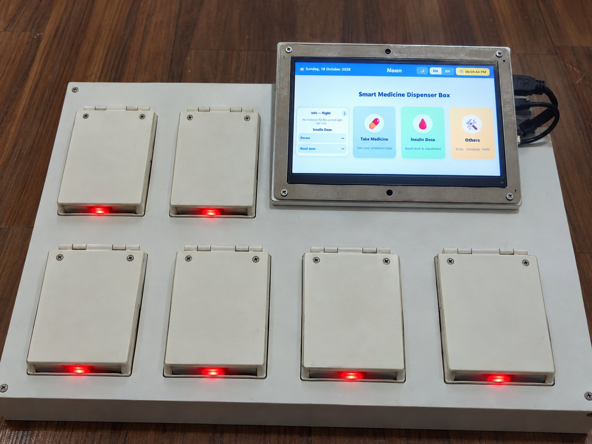
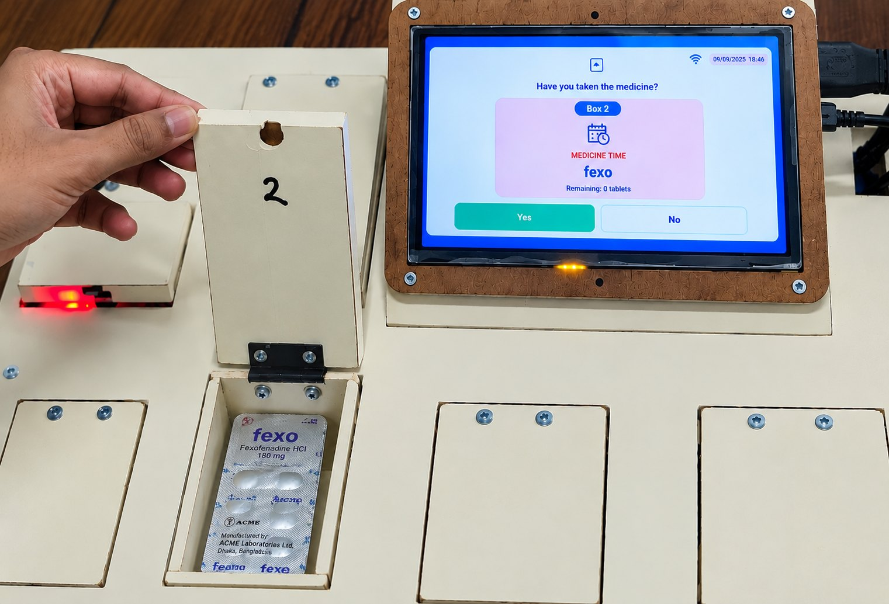
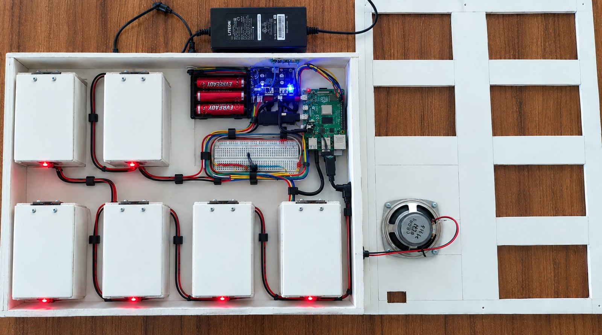
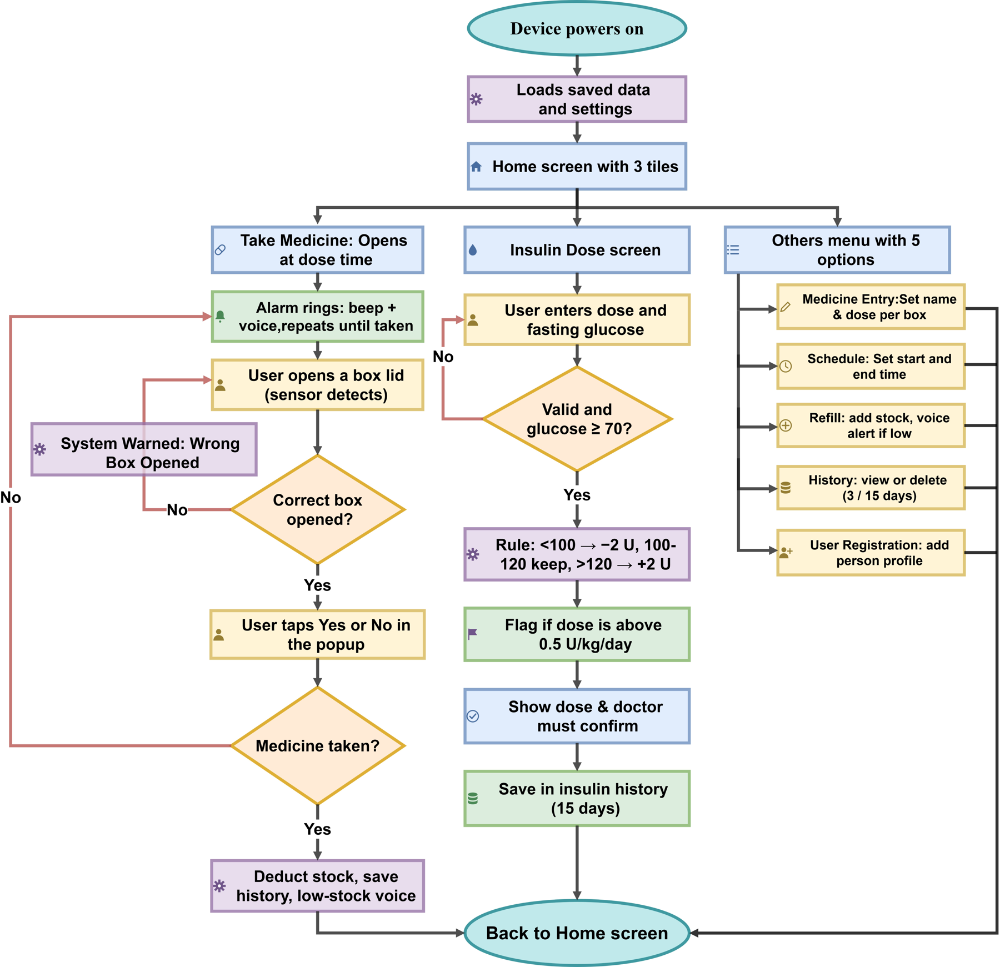

# 🤖 AMMAU: Smart Medicine Dispenser & Insulin Dose Support System

🎓 Final Year Project, Department of CSE, Daffodil International University

🎓 Research project, Quantum Robotics and Automation Research Group (QRARG)

A six-compartment smart medicine dispenser built on a Raspberry Pi 4. It reminds the user with Bangla and English voice alerts, watches every compartment lid with Hall-effect sensors, and includes a basal insulin dose adjustment screen for Type 2 diabetic patients. The full touch interface runs on a 7-inch display.



## 📑 Contents

[Overview](#-overview) · [Gallery](#-gallery) · [Features](#-features) · [How it works](#-how-it-works) · [Hardware](#-hardware) · [Software](#%EF%B8%8F-software) · [Installation](#%EF%B8%8F-installation) · [Project structure](#-project-structure) · [Safety](#%EF%B8%8F-medical-safety-disclaimer) · [Team](#-team) · [License](#-license)

## 📌 Overview

AMMAU goes beyond a normal reminder app by combining a physical box with a digital interface:

- A **Flask backend** on the Raspberry Pi reads six Hall-effect sensors over GPIO and sends box open/close events to the interface.
- A **touch interface** (single HTML page, designed and built entirely by [Mubas Sera Noon](https://github.com/Noon131)) shows the schedule, plays voice alerts, asks the user to confirm each dose, and keeps medicine and insulin history.
- An **insulin module** applies fixed clinical titration rules to a fasting glucose reading and always requires doctor confirmation.

## 📸 Gallery

### Medicine time

When a dose is due, the alarm rings and the user opens a box. The sensor detects which lid was opened, and the screen asks for confirmation. Opening the wrong box triggers a warning in Bangla and English.



### Inside the box

Raspberry Pi 4, battery pack and power board, breadboard wiring, six compartments with Hall-effect sensors and LED indicators, and the speaker.



### System flow



## ✨ Features

### 💊 Smart medication dispenser

- Six compartments, each tied to one schedule (for example Morning before meal, Noon after meal).
- Hall-effect sensor on every lid with debouncing, so open and close events are reliable.
- Warning when the **wrong box** is opened, and a confirmation prompt when the **correct box** is opened.
- Stock is deducted after the dose is confirmed, with a low-stock voice alert.

### 🔔 Reminders and voice

- Alarm with beep and voice that repeats until the dose is taken.
- Bangla and English voice clips played from local MP3 files, so no internet is needed.
- Pressing **No** brings the reminder back after one minute.

### 🩺 Basal insulin dose support

- User enters the current dose and fasting glucose. Glucose must be a valid value of **70 or above**.
- Rule-based titration:
  - fasting glucose **below 100**: reduce by **2 U**
  - **100 to 120**: keep the same dose
  - **above 120**: increase by **2 U**
- Flags any dose above **0.5 U/kg/day**.
- Shows the dose with a clear note that a **doctor must confirm** it.
- Saves insulin history for **15 days**.

### 🛠️ Others menu

- **Medicine Entry:** set the medicine name and dose per box.
- **Schedule:** set start and end time for each box.
- **Refill:** add stock, with a voice alert when stock runs low.
- **History:** view or delete medicine and insulin history.
- **User Registration:** add person profiles, with a user switcher on the home screen.

### 🌐 Interface

- English and Bangla (EN / BN toggle), day and night mode.
- Built-in on-screen keyboard (English, Bangla, and number pad), so no physical keyboard is needed.
- Automatic Bangla name suggestions for common medicine names.
- Full-screen kiosk mode on Raspberry Pi OS.

## 🔄 How it works

1. The device powers on, loads saved data and settings, and shows the home screen with three tiles: **Take Medicine**, **Insulin Dose**, **Others**.
2. At dose time, the alarm rings and repeats until the dose is taken.
3. The user opens a lid. The Hall-effect sensor reports the event to the Flask backend, and the interface polls the backend every 250 ms.
4. Wrong box: the system warns in both languages and keeps reminding. Correct box: the user taps **Yes** or **No** on the popup.
5. On **Yes**, stock is deducted and history is saved. Low stock triggers a voice alert.

## 🔧 Hardware

| Component | Purpose |
|-----------|---------|
| Raspberry Pi 4 Model B (4GB) | Main processing and control unit |
| Hall-effect sensors (A3144 / KY-003), 6 pcs | Lid open/close detection |
| Magnets | Trigger the sensor when a lid is closed |
| Six-compartment medicine box | Medicine organization |
| 7-inch HDMI touch display | User interface |
| Speaker and amplifier | Voice alerts |
| LEDs | Visual indication per compartment |
| Power adapter and battery pack | Power and backup |

### Default GPIO wiring (BCM)

| Box | Schedule label | BCM GPIO |
|:---:|----------------|:--------:|
| 1 | Morning before meal | 17 |
| 2 | Morning after meal | 18 |
| 3 | Noon before meal | 27 |
| 4 | Noon after meal | 22 |
| 5 | Night before meal | 23 |
| 6 | Night after meal | 24 |

The pins, sensor polarity (`closed_level`), debounce time and default schedules can all be changed in `config.json`.

## 🛠️ Software

| Layer | Technology |
|-------|------------|
| Backend | Python 3, Flask |
| Hardware access | RPi.GPIO |
| Interface | HTML, CSS, JavaScript (single page, served by Flask) |
| Voice | Pre-recorded MP3 clips in `static/audio/` |
| Display | Chromium in kiosk mode |
| Auto start | systemd service plus desktop launcher |

### Backend API

| Endpoint | Method | Purpose |
|----------|--------|---------|
| `/api/health` | GET | Check that the backend is running |
| `/api/status` | GET | Box states and hardware status |
| `/api/events` | GET | Box open/close event queue |
| `/api/schedule` | POST | Sync box schedules from the interface |
| `/api/warning/clear` | POST | Clear the wrong-box warning |
| `/api/mock/event` | POST | Simulate a box event (for testing without sensors) |
| `/api/kiosk/exit` | POST | Exit full-screen kiosk mode |

## ⚙️ Installation

### Requirements

- Raspberry Pi 4 Model B with Raspberry Pi OS
- Python 3 and Git
- Hall-effect sensors, magnets, speaker and display connected as described above

### Quick start

```bash
git clone https://github.com/Noon131/smart-medicine-dispenser.git
cd smart-medicine-dispenser
chmod +x run.sh
./run.sh
```

`run.sh` creates a virtual environment, installs the requirements and starts the server. Then open:

```
http://127.0.0.1:5000
```

From another device on the same network, use `http://<PI-IP>:5000`. Tap the screen once after loading so the browser allows audio playback.

### Auto start on the Raspberry Pi (kiosk)

```bash
./deploy/install.sh
sudo reboot
```

This installs a systemd service for the backend (starts at power-on and restarts after a crash), a desktop icon, and full-screen auto start of the interface. To remove it, run `./deploy/uninstall.sh`.

### Test without hardware

Set `"mock_mode": true` in `config.json`, or send events to `/api/mock/event`, to try the interface on a normal computer.

## 📁 Project structure

```
smart-medicine-dispenser/
├── assets/                              # Pictures used in this README
├── deploy/
│   ├── install.sh                       # systemd service, launcher, kiosk auto start
│   ├── kiosk.sh                         # Opens the interface full-screen in Chromium
│   └── uninstall.sh
├── static/
│   ├── audio/                           # Bangla and English voice clips (MP3)
│   └── icon.svg
├── Smart_medicine_dispenser_V75.html    # Touch interface (built by Noon)
├── app.py                               # Flask backend and Hall-sensor GPIO polling
├── config.json                          # GPIO pins, polarity, debounce, default schedule
├── requirements.txt
├── run.sh
├── README.md
└── README_BN.md                         # Bangla notes and change log
```

## ⚠️ Medical safety disclaimer

AMMAU is a research prototype. The insulin module gives **decision-support suggestions only** and is not a substitute for professional medical advice, diagnosis, or treatment. Insulin doses must always be reviewed and confirmed by a qualified doctor. Never change an insulin dose based only on this system.

The sensors detect that a lid was opened or closed. They do **not** verify that the medicine was swallowed.

## 👥 Team

**Quantum Robotics and Automation Research Group (QRARG)**

| Member | Role |
|--------|------|
| [Mubas Sera Noon](https://github.com/Noon131) | Student researcher. **Designed and developed the complete touch interface** (UI, screens, on-screen keyboard, voice flow and insulin screen) |
| Md. Sanaullah Islam Shovon | Student researcher |
| Dr. M. Akhtaruzzaman | Supervisor |

## 🏆 Recognition

- 🥇 **Champion**, IEB Poster Competition
- 🏅 **Merit Award**, Bangladesh ICT & Innovation Awards 2025
- 🔬 **Research Project Showcasing**, Patent Idea Competition 2025

## 📜 License

Developed for academic research, educational purposes and healthcare technology innovation. Please contact the project contributors before reusing or redistributing the project.

---

<p align="center"><strong>AMMAU: Making Medication Management Smarter.</strong><br><i>Designed and developed by Noon & Shovon. Complete interface by <a href="https://github.com/Noon131">Mubas Sera Noon</a>.</i></p>
